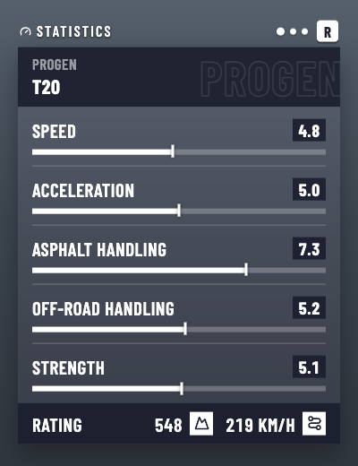
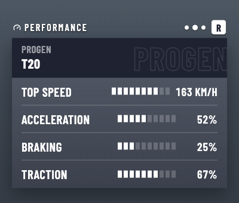
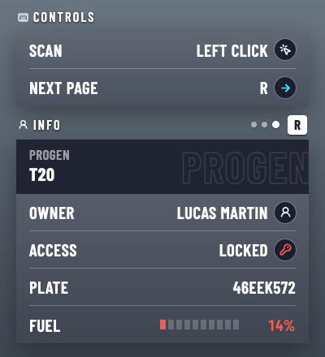

# sxHelpMenu

A FiveM library to show help menus and info widgets in the style of Grand Theft Auto VI (GTA 6). Other resources describe a menu in Lua, with pages of text rows, segmented bars, sliders and a footer, and sxHelpMenu draws it in the bottom right of the screen or at any of the nine anchors.





## Features

- **Display only**: the menus never take the focus, the player keeps walking, driving and shooting.
- **Pages**: a menu has one or more pages, with a title and an icon, switched with a key. The dots and the key are shown above the menu.
- **Rows**: text with an optional icon badge, segmented bar and slider with a value badge, each with a tone (`neutral`, `danger`, `safe`, `warning`, `accent` or a hex color).
- **Header and footer**: a dark header with a subtitle, a title and a watermark (text or image), and a dark footer with a label and values with icons. Both can change per page.
- **Positions**: `bottom-right` by default, or `top-left`, `top`, `top-right`, `left`, `center`, `right`, `bottom-left` and `bottom`, with an offset in `vw` / `vh`. Menus on the same anchor stack, up to `Config.StackLimit`.
- **Live updates**: update a row or the whole menu without replaying the opening animation.
- **Auto hide**: a duration after which the menu hides itself.
- **Per frame**: `ShowThisFrame` shows a menu while it is called every tick and hides it when the calls stop, like the native help texts.
- **Global hide**: the menus fade out in the pause menu, when the HUD is hidden or the screen faded out, and when a resource asks for it with `SetHidden`.
- **Cleanup**: the menus of a resource are hidden when it stops.
- **Glass**: the rows are drawn over a blurred copy of the game, rendered with WebGL since the CSS `backdrop-filter` does not see the game in FiveM.
- **Icons**: every [Lucide](https://lucide.dev/icons) icon by name (`gauge`, `car-front`…) or an image URL (`nui://my_resource/logo.png`).
- **Builder**: a Lua file to include in your resource with a chainable API, or plain exports.

## Dependencies

None.

## Installation

1. Clone the repository into your `resources` folder.

   ```bash
   git clone https://github.com/0xS4cha/sxHelpMenu.git
   ```

2. Build the interface, or download a release where `web/dist` is already built.

   ```bash
   cd sxHelpMenu/web
   npm install
   npm run build
   ```

3. Add the resource to your `server.cfg` before the resources that use it.

   ```cfg
   ensure sxHelpMenu
   ```

## Usage

| Key / command | Description |
| --- | --- |
| `R` / `helpmenu_nextpage` | Next page of the last shown menu that has several pages |

The key can be changed in *Settings > Key Bindings > FiveM*, the badge on the menus follows the key bound by the player.

Keys already used by the game, like `TAB` for the weapon wheel, cannot be bound this way since the game catches them first. Set `Config.Keys.control` to the [control](https://docs.fivem.net/docs/game-references/controls/) of this key instead, the key mapping is then not registered and the control is disabled and read while a menu with several pages is shown:

```lua
Config.Keys = {
    nextPage = 'TAB',
    control = 37,
}
```

### Builder

Add the builder to the `fxmanifest.lua` of your resource:

```lua
client_script '@sxHelpMenu/lib/menu.lua'
```

```lua
local menu = HelpMenu.new('vehicle')
    :Header('Progen', 'T20', { watermark = 'Progen' })

menu:Page('Statistics', 'gauge')
    :Slider('Speed', 4.8, { id = 'speed', max = 10 })
    :Slider('Acceleration', 5.0, { max = 10 })
    :Slider('Strength', 5.1, { max = 10 })
    :Footer('Rating', {
        { value = '548', icon = 'mountain' },
        { value = '219 KM/H', icon = 'route' },
    })

menu:Page('Info', 'user-round')
    :Text('Owner', 'Lucas Martin', { icon = 'user-round' })
    :Text('Access', 'Locked', { icon = 'key-round', tone = 'danger' })
    :Bar('Fuel', 0.14, { tone = 'danger' })

menu:Show()

menu:SetRow('speed', { value = 6.2 })
menu:SetPage('next')
menu:Hide()
```

| Method | Description |
| --- | --- |
| `HelpMenu.new(id?, options?)` | Creates a menu, `options` takes the fields of the menu below |
| `menu:Header(subtitle, title, options?)` | Header of the menu, `options` takes `watermark` and `image` |
| `menu:Position(position, offset?)` | Anchor and offset |
| `menu:Set(key, value)` | Sets any field of the menu |
| `menu:Page(title?, icon?, id?)` | Adds a page and returns it |
| `page:Text(label, value, options?)` | Adds a text row |
| `page:Bar(label, value, options?)` | Adds a segmented bar |
| `page:Slider(label, value, options?)` | Adds a slider |
| `page:Countdown(label, seconds, options?)` | Adds a countdown, its end is fixed when the row is created |
| `page:Footer(label, items)` | Footer of the page |
| `page:Header(subtitle, title, options?)` | Header of this page only |
| `menu:Show(duration?)` | Shows the menu, or updates it when it is already shown |
| `menu:ShowThisFrame()` | Shows the menu while it is called every tick, see [Per frame](#per-frame) |
| `menu:Refresh()` | Sends the changes made with the builder to a shown menu |
| `menu:SetRow(rowId, patch)` | Updates the rows with this `id` |
| `menu:SetPage(page)` / `menu:GetPage()` | `'next'`, `'prev'` or a page index starting at `0` |
| `menu:IsVisible()` / `menu:Hide()` | |

### Exports

```lua
local id = exports.sxHelpMenu:Show({
    id = 'controls',
    position = 'bottom',
    pages = {
        {
            title = 'Controls',
            icon = 'keyboard',
            rows = {
                { type = 'text', label = 'Scan', value = 'Left click', icon = 'mouse-pointer-click' },
                { type = 'text', label = 'Next page', value = 'R', tone = 'accent' },
            },
        },
    },
    duration = 10000,
})
```

| Export | Description |
| --- | --- |
| `Show(menu)` | Shows a menu, or updates it when its `id` is already shown. Returns the `id` |
| `ShowThisFrame(menu or id)` | Shows a menu while it is called every tick, see [Per frame](#per-frame). Returns the `id`, or `nil` when an `id` alone is not shown |
| `Update(id, patch)` | Replaces fields of a shown menu |
| `UpdateRow(id, rowId, patch)` | Replaces fields of the rows with this `id` |
| `Hide(id)` | Hides a menu |
| `HideAll()` | Hides the menus of the calling resource |
| `SetPage(id, page)` | `'next'`, `'prev'` or a page index starting at `0` |
| `GetPage(id)` | Index of the shown page |
| `IsVisible(id)` | |
| `SetHidden(hidden)` | Hides every menu while `true`, for cutscenes or a camera mode. Each resource has its own request, the menus show again when no resource asks for it and its request is dropped when it stops |
| `IsHidden()` | Whether the menus are hidden, by a rule of `Config.Hide` or a resource |
| `GetFocused()` | `id` of the menu driven by the page key |
| `GetPositions()` | List of the anchors |

### Per frame

`ShowThisFrame` is made to be called every tick. The first call sends the menu to the interface, the next calls only keep it alive, so they are cheap. When it is not called for `Config.TickTimeout` milliseconds, the menu is hidden.

```lua
CreateThread(function()
    while true do
        if IsNearShop() then
            exports.sxHelpMenu:ShowThisFrame(shopMenu)
        end
        Wait(0)
    end
end)
```

- The menu needs an `id`. The builder generates one.
- Pass the `id` alone after the first call to avoid sending the whole table every tick: `ShowThisFrame('shop')` returns `nil` when the menu is not shown, then pass the table again.
- The content is only sent on the first call. To change it, use `Update` or `UpdateRow`.
- Calling `Show` on the same `id` keeps the menu open without the per frame calls.

### Menu

| Field | Default | Description |
| --- | --- | --- |
| `id` | generated | Identifier of the menu |
| `position` | `'bottom-right'` | One of the nine anchors |
| `offset` | `{ x = 2.5, y = 6.0 }` | Distance to the edges in `vw` and `vh`. Menus with the same anchor and offset stack, a menu with another offset gets its own stack |
| `width` | `360` | Width in pixels |
| `scale` | `1.0` | Zoom of the whole menu |
| `header` | | `{ subtitle, title, watermark?, image? }` |
| `pages` | | List of pages. Without pages, `title`, `icon`, `rows` and `footer` of the menu make a single page |
| `page` | `0` | Page shown first |
| `glass` | `Config.Defaults.glass` | Blurs the game behind the rows, `false` keeps a plain translucent background |
| `key` | `true` | `true` shows the key bound by the player, a string shows this label instead, `false` hides it and ignores the key |
| `duration` | | Milliseconds before the menu hides itself |
| `order` | | Order of the menus on the same anchor, the lowest is the closest to the edge |

### Page

| Field | Description |
| --- | --- |
| `id` | Identifier of the page |
| `title` / `icon` | Shown above the menu |
| `header` | Replaces the header of the menu on this page |
| `rows` | List of rows |
| `footer` | `{ label?, items = { { value, icon?, tone? } } }` |

### Rows

| Field | Rows | Description |
| --- | --- | --- |
| `type` | all | `'text'`, `'bar'`, `'slider'` or `'countdown'` |
| `id` | all | Used by `UpdateRow` |
| `label` | all | Text on the left |
| `value` | all | Text for `text`, a number between `0` and `max` for `bar` and `slider`, seconds left for `countdown` |
| `tone` | all | `neutral`, `danger`, `safe`, `warning`, `accent` or a hex color |
| `icon` | `text`, `countdown` | Icon in a badge after the value, `timer` by default for `countdown` |
| `scramble` | `text` | `false` disables the scramble animation, useful for values updated often |
| `max` | `bar`, `slider` | Maximum of `value`, `1` by default |
| `display` | `bar`, `slider` | Text shown instead of the percentage, or of the value when `max` is set |
| `segments` | `bar` | Number of segments, `10` by default |
| `endsAt` | `countdown` | End of the countdown in `GetGameTimer()` milliseconds. Without it, `value` is converted on the first `Show`, set it for menus shown again with the same table |
| `done` | `countdown` | Text shown at the end instead of `00:00` |
| `doneTone` | `countdown` | Tone at the end |
| `thresholds` | `bar`, `slider` | List of `{ value, tone }`, in the unit of `value`. The row takes the tone of the lowest threshold that `value` is under or equal to, otherwise its `tone` |

```lua
page:Bar('Fuel', fuel, {
    max = 100,
    thresholds = {
        { value = 20, tone = 'danger' },
        { value = 50, tone = 'warning' },
    },
})
```

### Events

| Event | Arguments | Description |
| --- | --- | --- |
| `sxHelpMenu:ready` | | The interface is loaded |
| `sxHelpMenu:pageChanged` | `id`, `page` | The page of a menu changed |
| `sxHelpMenu:hiddenChanged` | `hidden` | The menus were hidden or shown again |

## Configuration

Everything lives in `shared/config.lua`.

| Key | Default | Description |
| --- | --- | --- |
| `Config.Keys.nextPage` | `'R'` | Default key of the next page, and label shown on the menus |
| `Config.Keys.control` | `nil` | Game control used instead of the key mapping, `37` for `TAB`. Disabled while a menu with several pages is shown |
| `Config.Defaults.position` | `'bottom-right'` | Anchor of the menus without `position` |
| `Config.Defaults.offset` | `{ x = 2.5, y = 6.0 }` | Offset of the menus without `offset` |
| `Config.Defaults.width` | `360` | Width of the menus without `width` |
| `Config.Defaults.scale` | `1.0` | Zoom of the menus without `scale` |
| `Config.Defaults.gap` | `1.2` | Space between the menus on the same anchor, in `vh` |
| `Config.Defaults.glass` | `true` | Blurs the game behind the rows of the menus without `glass` |
| `Config.Glass.enabled` | `true` | Turns the glass renderer on for every menu |
| `Config.Glass.fps` | `60` | Maximum refresh rate of the blur |
| `Config.Glass.downscale` | `4` | Resolution divider of the blurred image, higher is lighter and softer, from `1` to `8` |
| `Config.Glass.strength` | `2` | Number of blur passes, from `1` to `6` |
| `Config.Hide.pauseMenu` | `true` | Hides the menus in the pause menu |
| `Config.Hide.hudHidden` | `true` | Hides the menus when the HUD is hidden |
| `Config.Hide.screenFaded` | `true` | Hides the menus while the screen is faded out |
| `Config.Hide.cinematic` | `false` | Hides the menus in the cinematic camera |
| `Config.Hide.interval` | `100` | Milliseconds between two checks, only while a menu is shown |
| `Config.StackLimit` | `3` | Maximum menus in a stack (same anchor and offset), the oldest one is hidden when a new one is shown, `0` for no limit |
| `Config.TickTimeout` | `100` | Milliseconds without `ShowThisFrame` calls before the menu hides |

### Convars

| Convar | Default | Description |
| --- | --- | --- |
| `sx_locale` | | Forces the language, `setr sx_locale fr` |
| `sx_helpmenu_debug` | `0` | `1` prints trace logs |
| `sx_helpmenu_log_level` | `2` | `0` errors, `1` warnings, `2` info, `3` trace |

## How it works

```
core/           Module loader, class helper, logger, translations, utilities
modules/
  ui/           NUI bridge, messages are queued until the interface is ready
  menu/         Menus, pages, focus, page key and cleanup
  exports/      Public client API
lib/            Lua builder included by other resources
shared/         Configuration
translations/   Language files
web/            React, TypeScript and Tailwind interface
```

The client keeps every shown menu with the resource that showed it. A menu is checked and completed with the defaults of the config in Lua, then sent to the interface. Calling `Show` again with the same `id` updates the menu in place and keeps its page. The page key drives the last shown menu that has several pages, and only this one shows the key. When a resource stops, its menus are hidden.

The interface has one container per anchor. The menus of an anchor are stacked from the edge of the screen and slide in from it. The body of a menu animates its height between pages, and the rows slide in the direction of the page change.

The CSS `backdrop-filter` only blurs the page, and the game is not part of it, so the glass is drawn by a WebGL renderer in a worker on an `OffscreenCanvas` behind the menus. A texture set up with the game view hook of FiveM receives the frame of the game. Each frame, the renderer copies it at a lower resolution (`Config.Glass.downscale`), blurs it with a separable Gaussian (`Config.Glass.strength` passes, limited to the area around the menus), and draws it only under the rows, with the opacity of the menu so it follows the animations. The page reads the position of the rows once per frame and only sends them to the worker when they change, and the renderer stops when no menu uses the glass. In a browser, the glass falls back to the CSS blur.

In a browser, `npm run dev` shows a demo, `?position=bottom` moves it, `?page=1` opens another page, `?stack` adds a second menu, `?split` adds it with another offset and `R` switches the page.

## License

Released under the [MIT License](LICENSE).
